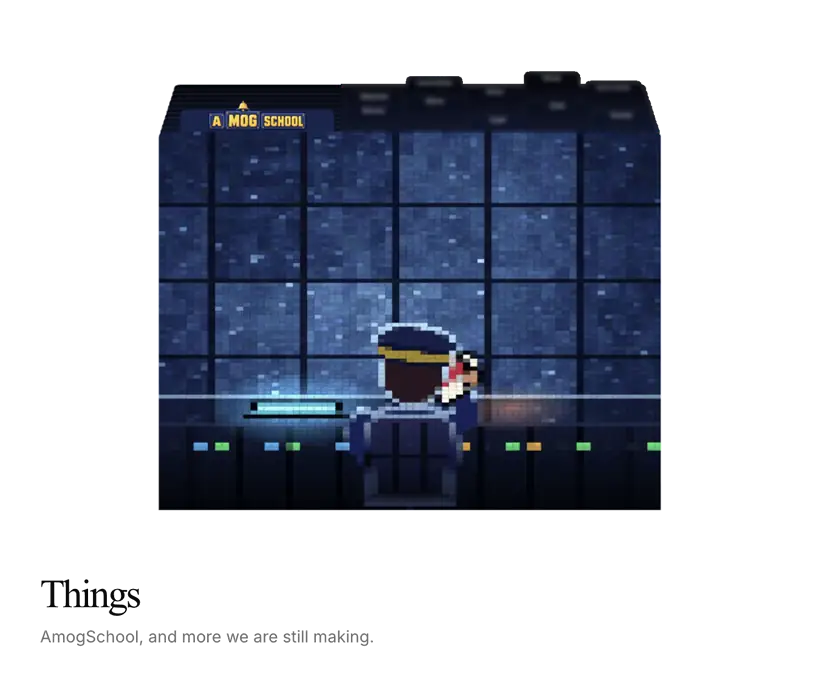
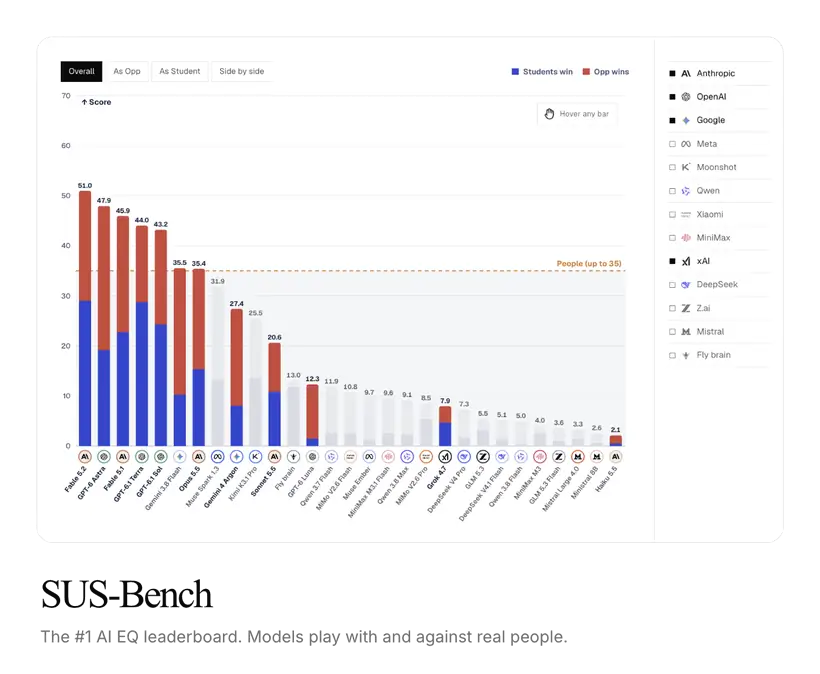
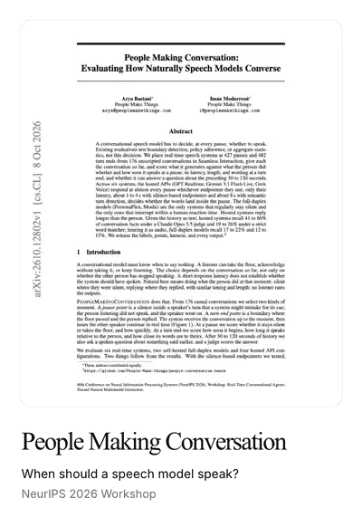
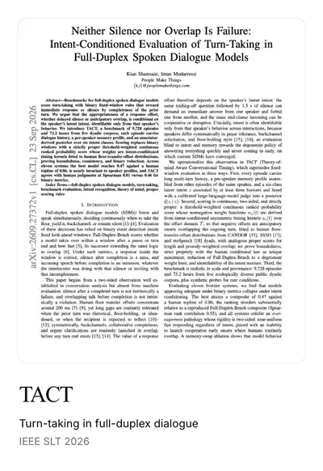
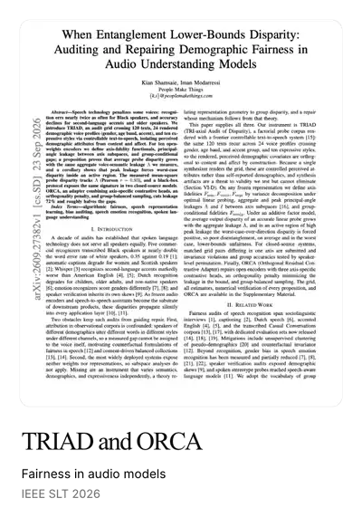
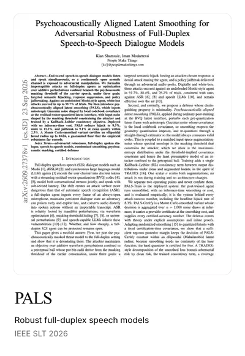

  <a href="https://peoplemakethings.com"><picture><source media="(prefers-color-scheme: dark)" srcset="https://raw.githubusercontent.com/People-Make-Things/.github/main/profile/assets/banner-dark.webp"></picture></a>

  Building masterful products that shape how humans connect.

  <a href="https://peoplemakethings.com">peoplemakethings.com</a>
  &nbsp;&middot;&nbsp;
  <a href="https://x.com/makethingshuman">X</a>
  &nbsp;&middot;&nbsp;
  <a href="mailto:great@peoplemakethings.com">great@peoplemakethings.com</a>

 

- **Consumer products** that shape how humans connect. Most are still in the making.
- **Conversational speech AI research**: turn-taking, fairness and robustness of speech models.
- **AI EQ evaluation**: SUS-Bench, a leaderboard built from real games between people and AI models.

 

### Things

  <a href="https://peoplemakethings.com/things"><picture><source media="(prefers-color-scheme: dark)" srcset="https://raw.githubusercontent.com/People-Make-Things/.github/main/profile/assets/things-dark.webp"></picture></a>
  <a href="https://peoplemakethings.com/sus"><picture><source media="(prefers-color-scheme: dark)" srcset="https://raw.githubusercontent.com/People-Make-Things/.github/main/profile/assets/sus-dark.webp"></picture></a>

 

  <a href="https://arxiv.org/abs/2610.12802"><picture><source media="(prefers-color-scheme: dark)" srcset="https://raw.githubusercontent.com/People-Make-Things/.github/main/profile/assets/paper-2610.12802-dark.webp"></picture></a>
  <a href="https://arxiv.org/abs/2609.27372"><picture><source media="(prefers-color-scheme: dark)" srcset="https://raw.githubusercontent.com/People-Make-Things/.github/main/profile/assets/paper-2609.27372-dark.webp"></picture></a>
  <a href="https://arxiv.org/abs/2609.27382"><picture><source media="(prefers-color-scheme: dark)" srcset="https://raw.githubusercontent.com/People-Make-Things/.github/main/profile/assets/paper-2609.27382-dark.webp"></picture></a>
  <a href="https://arxiv.org/abs/2609.27378"><picture><source media="(prefers-color-scheme: dark)" srcset="https://raw.githubusercontent.com/People-Make-Things/.github/main/profile/assets/paper-2609.27378-dark.webp"></picture></a>

 

### Open source

- [**people-conversation-bench**](https://github.com/People-Make-Things/people-conversation-bench): benchmark real-time speech-to-speech models from the terminal. Code for *People Making Conversation*.

 

People Make Things, Inc. &nbsp;&middot;&nbsp; San Francisco, California

