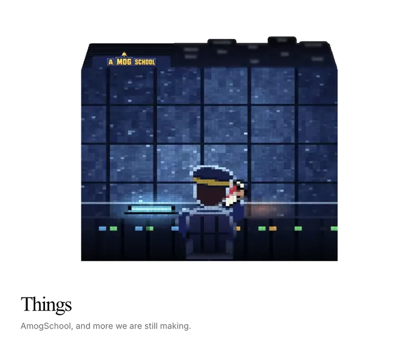
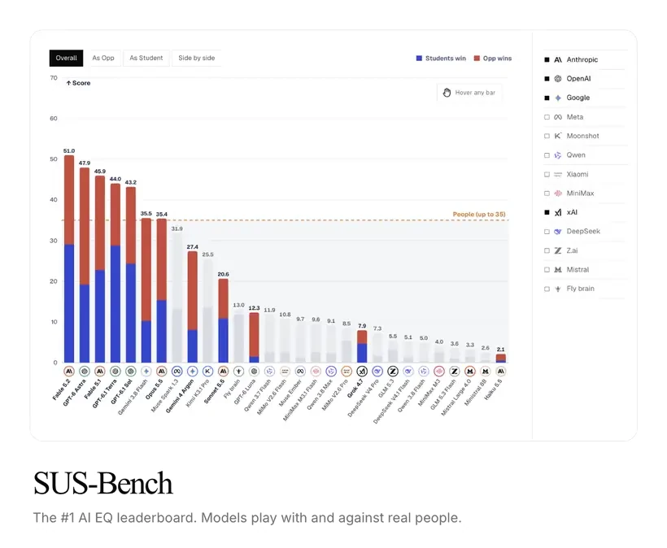
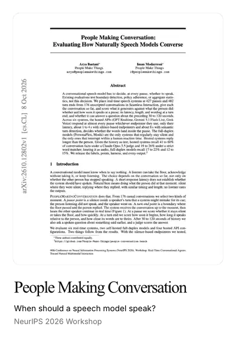
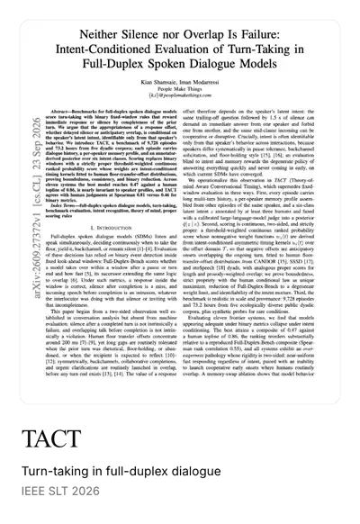
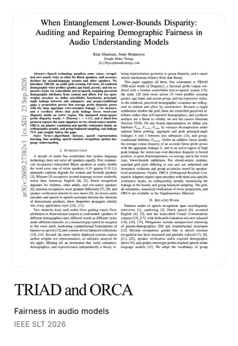
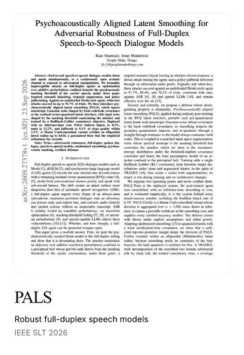

  

  Building masterful products that shape how humans connect.

  <a href="https://peoplemakethings.com">peoplemakethings.com</a>
  &nbsp;&middot;&nbsp;
  <a href="https://x.com/makethingshuman">X</a>
  &nbsp;&middot;&nbsp;
  <a href="mailto:great@peoplemakethings.com">great@peoplemakethings.com</a>

 

  
  

 

  
  
  
  

 

### Open source

- [**people-conversation-bench**](https://github.com/People-Make-Things/people-conversation-bench): benchmark real-time speech-to-speech models from the terminal. Code for *People Making Conversation*.

 

  

People Make Things, Inc. &nbsp;&middot;&nbsp; San Francisco, California

